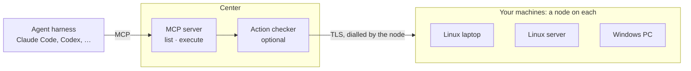
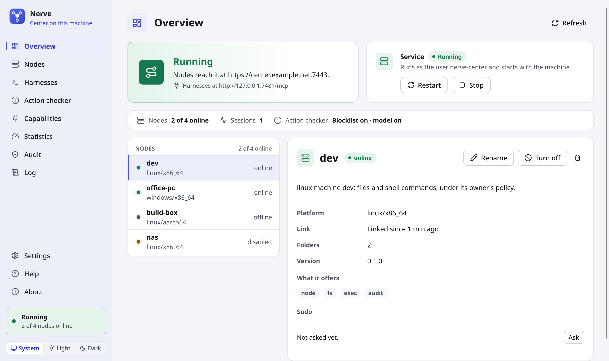

<p align="center">
  
</p>

<h1 align="center">Nerve Protocol</h1>

<p align="center">
  <b>Let your agent use your machines, only as far as you allow.</b><br>
  Linux and Windows · x86_64 and aarch64 · Apache 2.0
</p>

<p align="center">
  <a href="https://github.com/prometheion/nerve-protocol/releases"></a>
  <a href="https://github.com/prometheion/nerve-protocol/actions/workflows/ci.yml"></a>
  <a href="LICENSE"></a>
</p>

Nerve lets an agent harness read and write files and run commands on its
owner's machines. On each machine the owner decides what is allowed.
Everything else is refused.

## How it works



- **The center** is what your harness talks to: an MCP server with two
  tools, `list` and `execute`. It passes each call to the right machine.
- **A node** runs on each machine the agent may use. It dials the center,
  so the machine opens no port, and its own rules decide every call.
- **You** set those rules per machine, in the app, a web UI or the terminal.

| | |
|---|---|
| **Folders and modes** | In `folder` mode the agent works only in the folders you give it, with read, write and run rights, as an account of its own. `allowlist` allows only what a rule names; `user` runs as you |
| **Rules** | Allow and deny commands, protected paths, sudo for named commands |
| **Watch and stop** | An audit log of every call on each machine; `panic` ends every link at once |
| **Action checker** | An optional gate on the center: a blocklist (on by default) and a decision model. It can only refuse ([docs](docs/user/action-checker.md)) |

## Get started with the app

<picture>
  <source media="(prefers-color-scheme: dark)" srcset="docs/images/center-dark.png">
  
</picture>

The app `nerve` is one download for both roles. Get it from
[Releases](https://github.com/prometheion/nerve-protocol/releases/latest):

| Your machine | Take |
|---|---|
| Windows x64 | `nerve-x86_64-windows.exe` |
| Ubuntu, Debian | `nerve_<version>_amd64.deb` |
| Fedora | `nerve-<version>.x86_64.rpm` |
| Arch Linux | `nerve-<version>-1-x86_64.pkg.tar.zst` |
| Another Linux desktop (x86_64, GNOME or KDE Plasma) | `nerve-x86_64-linux` |

Install it and open **Nerve**. Its first step asks what this machine is:

1. **A center**, once, on the machine where your harness runs. It installs
   the center as a service and shows the **owner token**, which logs in to
   the center's pages. There, **Harnesses › Connect a harness** gives you
   the entry for your harness: the JSON, or a `claude mcp add` line.
2. **A node**, on each machine the agent may use. It installs the node as a
   service and pairs it with your center: **Pair a machine** on the center's
   **Nodes** page shows the link to paste. Then it asks for the mode and, in
   folder mode, a first folder.

A new pairing is in `folder` mode, as the account `nerve-run`, which may
also read what every account on the machine may read. The node's
**Permissions** page holds its folders and rules. To manage a machine from
the center instead, give that center the **Settings grant** on the node's
**Centers** page, but only a center you would also give a shell: it can then
widen its own rights ([the settings grant](docs/user/rules.md#the-settings-grant)).

### On Windows

The app is not signed yet: SmartScreen asks, **More info**, **Run anyway**.
The owner must be a local account with a password; a node asks for it.
Harnesses reach a center on Windows over HTTP MCP. There is no CLI on
Windows: everything is in the app ([Nerve on Windows](docs/user/windows.md)).

### On Linux

The app installs the role's terminal command, `nerve-node` or
`nerve-center`, as a link to itself
([install](docs/user/install.md#the-desktop-app)). The center's web UI is on
at `http://127.0.0.1:7480`.

## On a server

For a Linux server without a desktop, and on ARM, take the terminal programs
`nerve-center` and `nerve-node` (the `aarch64` files on ARM). They need no
libraries. Everything the app does is a command too
([commands](docs/user/commands.md)).

<details>
<summary><b>Install the center and the nodes in a terminal</b></summary>

1. The center, on the machine where your harness runs:

   ```sh
   curl -LO https://github.com/prometheion/nerve-protocol/releases/latest/download/nerve-center-x86_64-linux
   chmod +x nerve-center-x86_64-linux
   sudo ./nerve-center-x86_64-linux install
   ```

   It ends with the web UI's address, `http://127.0.0.1:7480`, the owner
   token that logs in there, and the address for harnesses.
   `sudo nerve-center owner-token` shows the token again. The web UI has
   the app's pages: **Harnesses › Connect a harness** connects your harness.

2. The node, on each machine the agent may use:

   ```sh
   curl -LO https://github.com/prometheion/nerve-protocol/releases/latest/download/nerve-node-x86_64-linux
   chmod +x nerve-node-x86_64-linux
   sudo ./nerve-node-x86_64-linux install
   ```

   At a terminal it asks for the pairing link (**Pair a machine**, or
   `sudo nerve-center pair`), the mode, a folder with its rights, and the
   network. Without a terminal (`-` reads the link from the next line,
   [pair](docs/user/pair.md)):

   ```sh
   nerve-node center add -
   nerve-node folder add ~/project rwx
   ```

   `nerve-node status` shows what to do next, and
   `nerve-node center settings on <center>` gives the settings grant. The
   install turns on the node's own web UI at `http://127.0.0.1:7470` and
   shows its first token once.

</details>

### A center your harness starts

A harness can also start the center itself, over stdio:

```json
{"mcpServers": {"nerve": {"command": "nerve-center"}}}
```

That center runs as you, so an agent with file or shell tools can read its
owner token (`nerve-center owner-token`) and log in to its web UI. The
service keeps the agent out ([center](docs/user/center.md)).

## Documentation

| For | Where |
|---|---|
| Running Nerve: install, pairing, folders and modes, rules, the web UIs, what it guards | [docs/user/](docs/user/README.md) |
| Building, changing and releasing Nerve: architecture, policy engine, sandbox, checks | [docs/dev/](docs/dev/README.md) |
| The protocol and the conformance suite | [docs/dev/spec/](docs/dev/spec/README.md), [schemas/](schemas), [crates/nerve-conformance](crates/nerve-conformance) |

## Contributing

See [CONTRIBUTING.md](CONTRIBUTING.md): how to build and check a change, and what a pull request brings.

## Security

Report a security hole privately, through **Report a vulnerability** on the
repository's Security tab (without that button, open an issue that says only
that you have a report, and no more). [SECURITY.md](SECURITY.md) says how, what is in
scope, what `update` trusts (the releases are not signed yet), and the known
limits.

## Licence

Nerve is under the [Apache License 2.0](LICENSE). The desktop app
`nerve` is drawn with [Slint](https://slint.dev), which it uses
under Slint's Royalty-free license 2.0: the app shows Slint's notice in its
About dialog ([its licence](crates/nerve/LICENSE.md)).
[NOTICE](NOTICE) lists the works Nerve includes.
